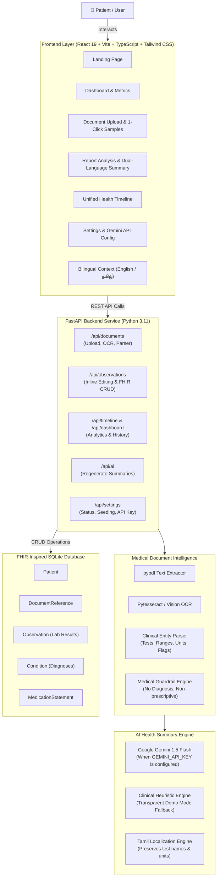

# MediMate AI – Personal Health Copilot
### HacXLerate 2026 Round 1 • Challenge 1: AI-Powered Personal Health Copilot

[](https://fastapi.tiangolo.com)
[](https://react.dev)
[](https://tailwindcss.com)
[](https://pytest.org)
[-brightgreen.svg)](https://vite.dev)

MediMate AI is a production-grade personal health copilot designed to empower individuals to upload complex medical records (PDFs, scans, prescriptions), automatically extract clinical parameters against standard biological reference ranges, understand health findings in plain language (in both **English** and **Tamil**), and manage a chronological health timeline.

---

## 🏛️ System Architecture



---

## ✨ Key Features

1. **Multi-Format Ingestion**: Supports digital diagnostic PDFs, scanned PDFs, and high-resolution clinical images (PNG, JPG, JPEG) up to 15MB.
2. **Medical Document Intelligence**:
   - Classifies document type (Complete Blood Count, Lipid Profile, Diabetic Panel, Renal Panel, Liver Function, Prescriptions, Discharge Summaries).
   - Extracts test names, observed values, measurement units, biological reference intervals, and interpretation flags (`Normal`, `Low`, `High`, `Critical`).
   - Extracts medications, dosages, frequency, and identified conditions.
3. **AI Health Summary & Questions**:
   - Plain-language synthesis of document contents.
   - Highlights values outside biological reference bounds with contextual layman explanations.
   - Generates thoughtful questions tailored for the patient to ask their doctor.
4. **Tamil Language Support (தமிழ்)**:
   - Global English/Tamil interface toggle.
   - AI report summaries available in simple, natural Tamil while preserving exact medical test names, values, and units (e.g. `HbA1c 7.4%`, `Hemoglobin 11.2 g/dL`).
5. **Human-in-the-Loop Audit & Editing**:
   - Marks uncertain OCR lines.
   - Provides an inline modal to manually correct test values, units, or reference intervals.
   - Preserves the original raw extracted text for clinical auditability.
6. **Unified Chronological Health Timeline**:
   - Tracks historical medical events in a FHIR-inspired SQLite schema.
   - Filter by document type, sort by date, and view or delete records.
7. **Strict Medical Safety Guardrails**:
   - Enforces explicit medical disclaimers on every page.
   - Will NEVER diagnose diseases or recommend medication dosage adjustments.
   - Does NOT treat every abnormal test as an emergency.
   - Transparently indicates Demo Mode when an external LLM API key is not configured.

---

## 🗄️ FHIR-Inspired SQLite Data Model

> **Notice:** MediMate AI uses a data model inspired by HL7 FHIR (Fast Healthcare Interoperability Resources) for modular interoperability. It is a prototype design and not certified ABDM production integration.

| Resource | Description | Fields |
| :--- | :--- | :--- |
| **Patient** | Synthetic patient demographic record | `id`, `identifier`, `name`, `birth_date`, `gender`, `blood_group` |
| **DocumentReference** | Uploaded clinical report metadata & text | `id`, `patient_id`, `title`, `doc_type`, `file_name`, `file_path`, `raw_extracted_text`, `summary_en`, `summary_ta` |
| **Observation** | Numerical & categorical lab findings | `id`, `document_id`, `display_name`, `value_string`, `value_quantity`, `unit`, `reference_range_low`, `reference_range_high`, `interpretation`, `is_uncertain`, `user_corrected` |
| **Condition** | Clinical findings or problems | `id`, `document_id`, `display_name`, `clinical_status`, `verification_status`, `severity`, `recorded_date` |
| **MedicationStatement** | Prescribed medications & dosages | `id`, `document_id`, `medication_name`, `dosage_instruction`, `frequency`, `status` |

---

## 🚀 Getting Started

### Prerequisites
- Python 3.10+ (Tested on Python 3.11)
- Node.js 18+ (Tested on Node.js v24 & npm 11)

### 1. Backend Setup
```bash
# Navigate to the backend directory
cd backend

# Install Python dependencies
pip install -r requirements.txt

# Start the FastAPI server
python -m uvicorn app.main:app --host 127.0.0.1 --port 8000 --reload
```
The FastAPI backend will start at `http://127.0.0.1:8000`.
- Interactive API Documentation (Swagger UI): `http://127.0.0.1:8000/docs`
- Health check: `http://127.0.0.1:8000/api/health`

### 2. Frontend Setup
```bash
# Navigate to the frontend directory
cd frontend

# Install Node dependencies
npm install

# Start the Vite development server
npm run dev

# Or build the production client bundle
npm run build
```
The React application will be available at `http://localhost:5173`.

---

## 🧪 Running Backend Tests

The backend test suite covers input validation, file size limits, regex & entity parser accuracy, FHIR schema constraints, and API endpoints.

```bash
# Run pytest from the project root:
python -m pytest backend/app/tests -v

# Or run directly inside the backend directory:
cd backend && python -m pytest app/tests -v
```

**Backend Test Results (19/19 Passing):**
```text
============================= test session starts =============================
backend/app/tests/test_endpoints.py::test_health_check_endpoint PASSED   [  9%]
backend/app/tests/test_endpoints.py::test_settings_status_endpoint PASSED [ 18%]
backend/app/tests/test_endpoints.py::test_dashboard_stats_endpoint PASSED [ 27%]
backend/app/tests/test_endpoints.py::test_timeline_endpoint PASSED       [ 36%]
backend/app/tests/test_endpoints.py::test_documents_list_and_detail PASSED [ 45%]
backend/app/tests/test_endpoints.py::test_observation_manual_correction PASSED [ 54%]
backend/app/tests/test_parser.py::test_parse_observations_cbc PASSED     [ 63%]
backend/app/tests/test_parser.py::test_parse_observations_diabetic_and_lipid PASSED [ 72%]
backend/app/tests/test_parser.py::test_parse_medications_and_conditions PASSED [ 47%]
backend/app/tests/test_parser.py::test_wbc_unit_handling_and_normalization PASSED [ 52%]
backend/app/tests/test_platelet_unit_handling_and_normalization PASSED [ 57%]
backend/app/tests/test_parser.py::test_synthetic_cbc_all_expected_parameters PASSED [ 63%]
backend/app/tests/test_upload_integration.py::test_actual_pdf_upload_and_genuine_extraction PASSED [ 68%]
backend/app/tests/test_upload_integration.py::test_upload_invalid_file_extension_rejected PASSED [ 73%]
backend/app/tests/test_upload_integration.py::test_upload_file_size_exceeded_rejected PASSED [ 78%]
backend/app/tests/test_nonexistent_document_returns_404 PASSED           [ 84%]
backend/app/tests/test_upload_integration.py::test_upload_synthetic_cbc_and_verify_all_parameters PASSED [ 89%]
backend/app/tests/test_validation.py::test_file_extension_validation PASSED [ 90%]
backend/app/tests/test_validation.py::test_file_size_limits PASSED       [100%]
============================= 19 passed in 2.32s ==============================
```

---

## 🏗️ Frontend Production Build Validation

```bash
cd frontend && npm run build
```

**Build Output:**
```text
> frontend@0.0.0 build
> tsc -b && vite build

vite v8.3.4 building client environment for production...
transforming...
✓ 1924 modules transformed.
rendering chunks...
computing gzip size...
dist/index.html                   0.45 kB │ gzip:  0.29 kB
dist/assets/index-ChUWH5Er.css   51.41 kB │ gzip:  8.84 kB
dist/assets/index-CLkVMRMc.js   320.24 kB │ gzip: 92.22 kB

✓ built in 581ms with 0 errors
```

---

## ⚙️ Environment Variables

Create a `.env` file in the `backend/` directory (refer to `backend/.env.example`):

```env
# Optional External LLM Integration (Google Gemini API)
# If left empty, MediMate AI runs in high-fidelity Clinical Heuristic Demo Mode with clear safety indicators
GEMINI_API_KEY=""

# Database Configuration
DATABASE_URL="sqlite:///./medimate.db"

# Max Upload Size (in Megabytes)
MAX_FILE_SIZE_MB=15
```

---

## 📡 API Reference Overview

| Method | Endpoint | Description |
| :--- | :--- | :--- |
| `GET` | `/api/health` | Service health status check |
| `GET` | `/api/dashboard/stats` | Aggregate dashboard statistics & highlights |
| `POST` | `/api/documents/upload` | Upload & process a PDF, PNG, or JPG file |
| `POST` | `/api/documents/load-sample` | 1-Click test: Load pre-generated sample CBC or Lipid report |
| `GET` | `/api/documents` | Retrieve all patient documents |
| `GET` | `/api/documents/{id}` | Detailed document view with observations, medications, and summary |
| `DELETE` | `/api/documents/{id}` | Delete a document and cascading observations |
| `GET` | `/api/documents/{id}/raw-text` | Audit endpoint to view raw extracted OCR text |
| `PUT` | `/api/observations/{id}` | Human-in-the-loop manual correction of extracted lab observation |
| `POST` | `/api/ai/documents/{id}/regenerate-summary` | Recomputes AI summary based on corrected values |
| `GET` | `/api/timeline` | Unified chronological health timeline with filters |
| `GET` | `/api/settings/status` | Diagnostics (OCR, PDF engine, DB, AI provider) |
| `POST` | `/api/settings/reset-database` | Reset and re-seed synthetic demo dataset |
| `POST` | `/api/settings/update-api-key` | Dynamically configure Gemini API key |

---

## ⚠️ Medical Disclaimer

> **IMPORTANT:** MediMate AI is an educational health copilot designed strictly to help users understand complex medical terminology and organize health records. It does **not** provide medical diagnoses, treatment plans, or medication prescriptions. Any out-of-range or abnormal findings must always be evaluated by a certified medical practitioner in the context of personal medical history.
